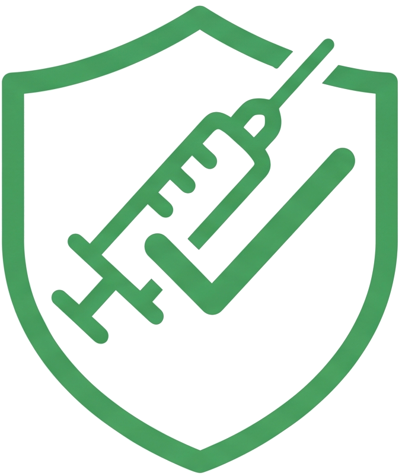

# SaludVac



**SaludVac** es una aplicación web académica para organizar esquemas de vacunación y validar sus reglas. Incluye un panel visual para personal de salud y un área técnica independiente para administrar el lenguaje específico de dominio (DSL).

> Las reglas incluidas son ejemplos técnicos y no sustituyen recomendaciones médicas oficiales.

## Objetivo del proyecto

El proyecto pone en práctica las etapas principales de un compilador mediante un lenguaje sencillo de vacunación:

1. Análisis léxico: identifica tokens, palabras reservadas, números y símbolos.
2. Análisis sintáctico: comprueba que las reglas respeten la gramática definida.
3. Análisis semántico: valida edades, dosis y reglas duplicadas.

## Tecnologías

- Python
- Flask
- HTML, CSS y JavaScript

## Requisitos

- Python 3.10 o superior
- `pip`

## Instalación

```powershell
git clone <URL-DEL-REPOSITORIO>
cd SaludVac
python -m venv .venv
.\.venv\Scripts\Activate.ps1
pip install -r requirements.txt
```

En macOS o Linux, activa el entorno virtual con:

```bash
source .venv/bin/activate
```

## Ejecución

```powershell
python app.py
```

Después, abre [http://127.0.0.1:5000/](http://127.0.0.1:5000/) en el navegador.

## Interfaces de la aplicación

### Panel clínico (`/`)

Dirigido al personal de salud. Permite agregar, quitar y revisar dosis desde formularios visuales, sin escribir código. El esquema se organiza automáticamente por edad y puede validarse para detectar dosis duplicadas o datos inconsistentes.

### Administración (`/administracion`)

Dirigida al personal administrador del sistema. Incluye el editor de reglas DSL y el resultado detallado de los análisis léxico, sintáctico y semántico.

## Lenguaje SaludVac DSL

Cada regla registra una vacuna, la edad en meses y el número de dosis.

### Sintaxis

```text
A_LOS <EDAD> MESES: <VACUNA>, DOSIS <NUMERO>;
```

### Ejemplo

```text
A_LOS 2 MESES: PENTAVALENTE, DOSIS 1;
A_LOS 4 MESES: NEUMOCOCO, DOSIS 2;
```

### Reglas de validación

- La edad y la dosis deben ser mayores que cero.
- La vacuna se escribe con letras mayúsculas, números o guiones bajos.
- No se admiten reglas duplicadas con la misma edad, vacuna y dosis.
- Cada regla debe terminar con punto y coma (`;`).

## Estructura

```text
SaludVac/
├── app.py                  # Servidor Flask y endpoints de análisis
├── compiler/
│   ├── lexer.py            # Analizador léxico
│   ├── parser.py           # Analizador sintáctico
│   ├── semantic.py         # Analizador semántico
│   └── symbols.py          # Símbolos del lenguaje
├── static/
│   ├── css/styles.css      # Estilos de la interfaz
│   ├── img/                # Logo e imágenes
│   └── js/
│       ├── app.js          # Lógica del área administrativa
│       └── dashboard.js    # Lógica del panel clínico
├── templates/
│   ├── index.html          # Panel clínico
│   └── admin.html          # Área de administración
└── requirements.txt        # Dependencias del proyecto
```

## API disponible

| Método | Ruta | Descripción |
| --- | --- | --- |
| `POST` | `/api/analizar` | Ejecuta el análisis léxico. |
| `POST` | `/api/sintaxis` | Ejecuta el análisis sintáctico. |
| `POST` | `/api/semantica` | Ejecuta el análisis semántico. |

Todas las rutas reciben un JSON con la propiedad `codigo`:

```json
{
  "codigo": "A_LOS 2 MESES: PENTAVALENTE, DOSIS 1;"
}
```

## Autoría

Proyecto académico de Lenguajes y Autómatas II.
